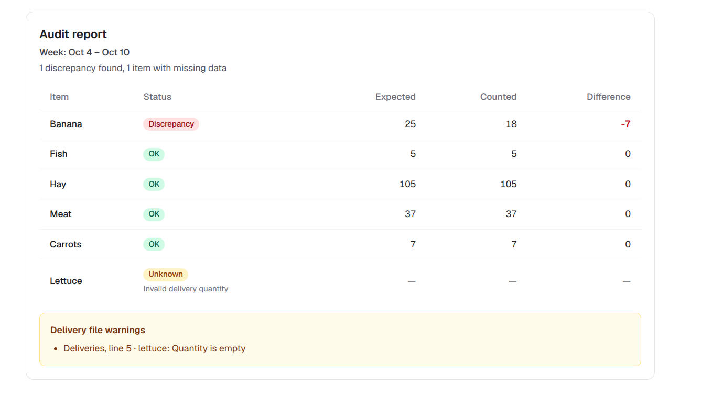

# FaunaFlow — Zoo Food Audit

FaunaFlow reconciles food deliveries, keeper usage logs, and end-of-week inventory.
It flags shortages and surpluses, while keeping missing or unreliable data separate
from actual discrepancies. The sample solves the banana mystery: **7 bananas are
unaccounted for**.

Built with strict TypeScript for explicit data contracts, Next.js and React for
the upload UI and server processing, and `csv-parse` for reliable CSV handling.

## Run it

Supported Node versions are 22.13+ within Node 22, any Node 24 release, or Node
26 and newer (`^22.13.0 || ^24.0.0 || >=26.0.0`). Node 24 is the development
default pinned in `.nvmrc`, not a requirement. If you use nvm:

```bash
nvm use
npm ci
npm run dev
```

Otherwise, use a supported Node version and run the two npm commands. Open
[localhost:3000](http://localhost:3000), select a week, and upload the files from
[`sample-data/`](sample-data/):

- **Deliveries:** [`delivery.txt`](sample-data/delivery.txt)
- **Usage log:** [`usage.csv`](sample-data/usage.csv)
- **Inventory:** [`inventory.json`](sample-data/inventory.json)

Click **Run audit** to see the report. These files contain the same data used by
the sample test fixtures.

To build and run in production mode:

```bash
npm run build
npm start
```

## Sample result



Lettuce remains unknown because its delivery quantity is empty; the report also
shows a warning identifying the offending line.

## Design decisions

I kept file parsing, the stock calculation, and the UI separate. The parsers
read each format; the calculation works out `expected = delivered − used` and
`difference = counted − expected`. That logic is plain TypeScript, so adding a
new file format or a different way to display the report doesn't mean rewriting
the calculation.

Each audit creates its own maps and arrays, so concurrent runs don't share data.
Shared settings are readonly and frozen, including nested arrays. Strict
TypeScript checks help catch missing values, and each report status has its own
type so an UNKNOWN item can't accidentally be treated as a completed calculation.

The browser catches common mistakes early: wrong file extensions, oversized
uploads, or missing files. It also disables the submit button while an audit
runs. The server checks the uploads again because requests can bypass the UI,
then reads the files and runs the calculation. Keeping this on the server gives
us logs when something goes wrong and a straightforward place to save reports
when that feature is needed.

A bad delivery value shouldn't stop the rest of the audit. It gets a warning
and an UNKNOWN result, with the file and line identified where possible. Other
input errors explain what needs fixing. Unexpected errors are logged on the
server without exposing internal details to the user, and the UI explains when
a selected file can't be read or a request fails.

A few assumptions keep the results predictable: item names ignore case and
surrounding whitespace, repeated entries sum up, and no usage entry means zero
used. Quantities must be non-negative whole numbers. The CSV parser handles
quoted fields, and arithmetic checks prevent large numbers from silently
rounding into a wrong result.

## Development and checks

The approach was TDD: start with focused behavior tests, implement the behavior,
then add regression and UI coverage. Vitest covers parsers, reconciliation, and
the audit pipeline; React Testing Library covers form and report behavior.
Cases include the supplied sample, quoted CSV, missing and invalid values,
arithmetic overflow, upload failures, and loading and result states.

Claude Code was used to write test cases and prepare sample data for edge cases.

Run the checks locally:

```bash
npm test
npm run typecheck
npm run lint
npm run format:check
```

Typechecking generates Next.js route types before running TypeScript. ESLint
checks code quality, and Prettier keeps formatting consistent. GitHub Actions
runs all four checks plus a production build on pull requests and pushes to
`main`, across Node 22.13, 24, and 26.

## Growing into a SaaS

I would add authentication and zoo memberships, then persist reports with tenant
ownership. Every report read and write would enforce access on the server using
the user's authenticated membership, rather than trusting a zoo ID supplied by
the browser. Each zoo would only access its own reports. The independent
reconciliation core could stay in place while storage, finance integrations, and
restock alerts are added around it.

Currently, reports are not saved, the week selection labels the report without
changing the calculation, and changed inputs require rerunning the audit.

## Assignment feedback

The focused reconciliation problem leaves useful room to demonstrate correctness,
error handling, managing test cases. The mix of formats and incomplete delivery
data makes the trade-offs concrete without needing a large application.
